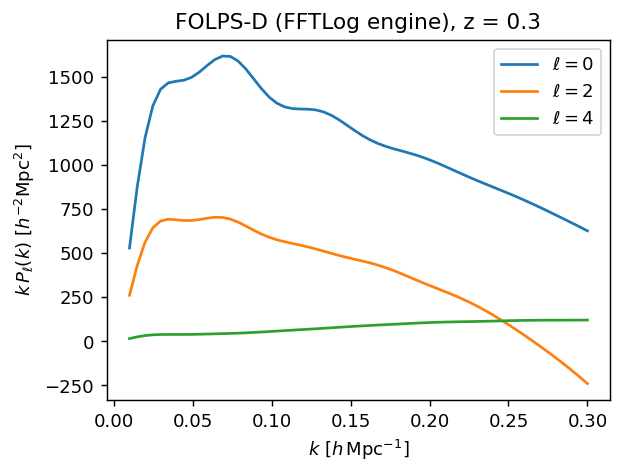
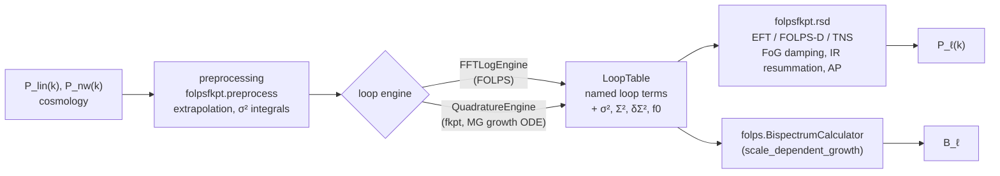
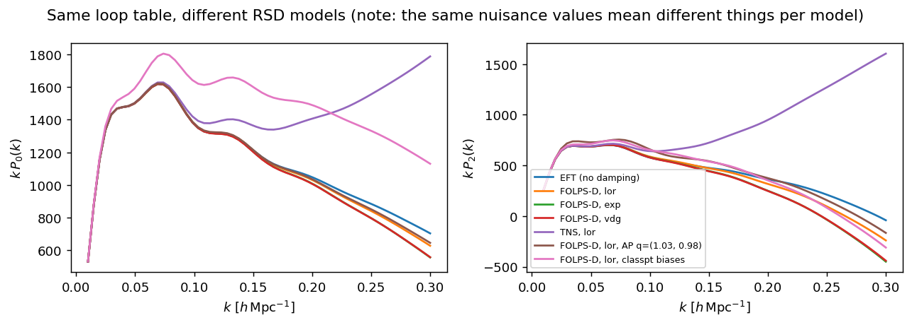
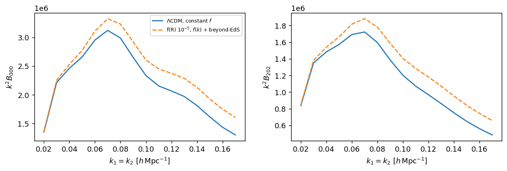
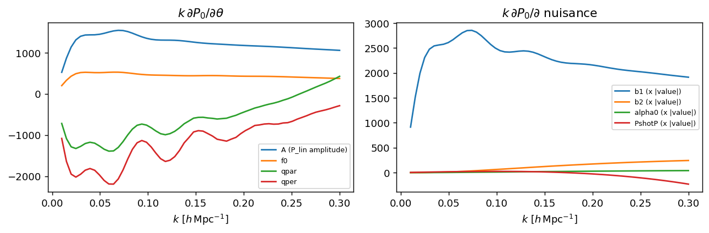
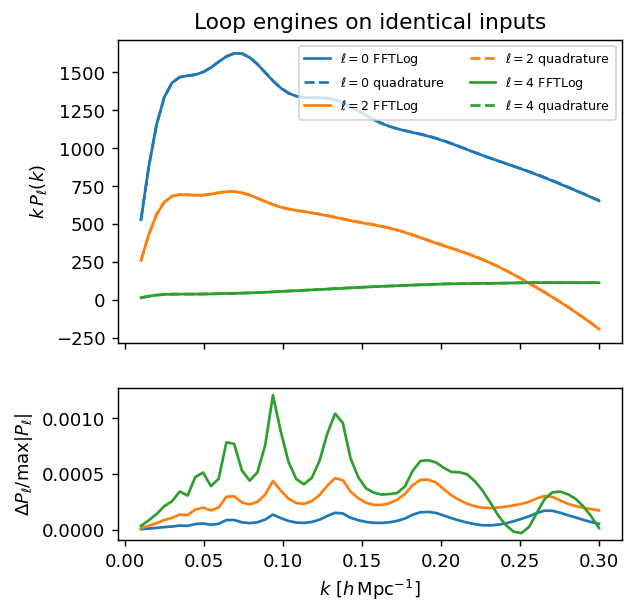
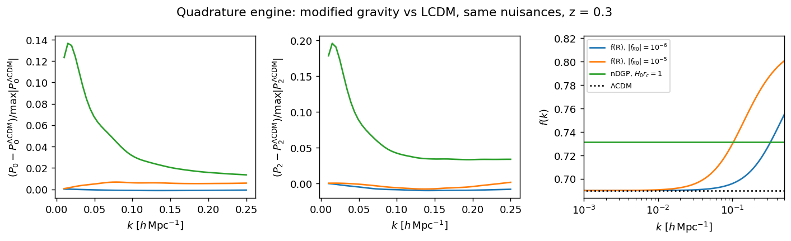

# folpsfkpt

**One pipeline for [FOLPS](https://github.com/cosmodesi/FolpsD) and [fkpt](https://github.com/gqcristhian/fkptjax_muMG):
shared preprocessing and redshift-space postprocessing, with a switchable one-loop engine.**

FOLPS and fkpt compute the same thing, the one-loop galaxy power spectrum (and tree-level bispectrum) in
redshift space, with the same structure:

```
input P_lin(k) ──► preprocessing ──► loop ENGINE ──► postprocessing (RSD, IR resummation, AP) ──► P_ell(k), B_ell
```

Only the engine really differs. FOLPS evaluates the loop integrals with precomputed **FFTLog** matrices
(fast, ΛCDM/EdS-like kernels with f(k) from massive neutrinos). fkpt evaluates them by **Q/R quadrature**
with "fk"-kernels from a scale-dependent growth ODE (modified gravity: f(R), nDGP, μ(a,k)
parametrisations, ...). Everything else was duplicated, and had drifted apart. `folpsfkpt` keeps one copy
of the shared stages and lets you swap the engine with a single line, while reproducing both original
codes to machine precision ([validation](#validation)).

> **Status.** Working and validated, not yet merged upstream. It runs on top of FolpsD and fkptjax
> branches (`unified-pipeline`) that carry the changes listed [below](#changes-to-folpsd-and-fkptjax);
> `pip install` pulls those automatically. Upstream pull requests are planned.

---

## Contents

- [Installation](#installation)
- [Quickstart](#quickstart)
- [How it fits together](#how-it-fits-together)
- [Choosing an engine](#choosing-an-engine)
- [Redshift-space multipoles: models and options](#redshift-space-multipoles-models-and-options)
- [The LoopTable](#the-looptable)
- [Nuisance parameters](#nuisance-parameters)
- [Bispectrum](#bispectrum)
- [jit and gradients](#jit-and-gradients)
- [Examples](#examples)
- [Changes to FolpsD and fkptjax](#changes-to-folpsd-and-fkptjax)
- [Validation](#validation)
- [Tests](#tests)
- [Notes and known differences](#notes-and-known-differences)
- [Credits and citation](#credits-and-citation)

---

## Installation

Python ≥ 3.10.

```bash
pip install "folpsfkpt[examples] @ git+https://github.com/jamesrohlf/folpsfkpt"
```

This also installs the `unified-pipeline` branches of FolpsD (module `folps`) and fkptjax (module
`fkptjax`) from GitHub. To work on the code:

```bash
git clone https://github.com/jamesrohlf/folpsfkpt
pip install -e "./folpsfkpt[examples,test]"
```

If you already have FolpsD / fkptjax checkouts, put them on the `unified-pipeline` branch and install
them in editable mode first (`pip install -e .` in each); pip then keeps them.

**Two settings every script needs**, before JAX is first used:

```python
import os
os.environ["FOLPS_BACKEND"] = "jax"            # FOLPS's JAX backend (needed for jit / gradients)
import jax
jax.config.update("jax_enable_x64", True)      # loop integrals need double precision
```

CPU is fine for everything here. On a GPU, install the matching `jax[cuda12]`.

## Quickstart

```python
import os
os.environ["FOLPS_BACKEND"] = "jax"
import jax, jax.numpy as jnp, numpy as np
jax.config.update("jax_enable_x64", True)

from folps import extrapolate_pklin, get_pknow_jax
from folpsfkpt import FFTLogEngine, pk_multipoles

# linear power spectrum at z (any Boltzmann code); k in h/Mpc, log-spaced from ~1e-4 to a few h/Mpc
k, pk = np.loadtxt("examples/data/pk_lin_z0.3.txt", unpack=True)
cosmo = dict(z=0.3, h=0.6711, Omega_m=0.3212, f0=0.6881, fnu=0.00445)   # fnu = Omega_nu / Omega_m

# no-wiggle spectrum (FOLPS's BAO filter)
k_ext, pk_ext = extrapolate_pklin(k=k, pk=pk)
k_nw, pk_nw = get_pknow_jax(k=jnp.asarray(k_ext), pk=jnp.asarray(pk_ext), h=cosmo["h"])
pknow = np.interp(k, np.asarray(k_nw), np.asarray(pk_nw))

engine = FFTLogEngine(A_full=True)                               # builds the FFTLog matrices once
table = engine(jnp.asarray(k), jnp.asarray(pk), jnp.asarray(pknow), **cosmo)   # all one-loop terms

# b1, b2, bs2, b3nl, alpha0, alpha2, alpha4, ctilde, alphashot0, alphashot2, PshotP, X_FoG_p
pars = jnp.array([1.645, -0.46, -0.37, 0.065, 3.0, -28.9, 0.0, 0.0, 0.08, -8.1, 4720., 1.0])
kobs = jnp.linspace(0.01, 0.3, 60)
P0, P2, P4 = pk_multipoles(table, kobs, pars, model="FOLPSD", damping="lor")
```

Swap the engine for fkpt's quadrature, e.g. Hu–Sawicki f(R), and keep everything else:

```python
from folpsfkpt import QuadratureEngine
table = QuadratureEngine(model="HS", fR0_HS=1e-5, rescale_PS=True)(k, pk, pknow, **cosmo)
P0, P2, P4 = pk_multipoles(table, kobs, pars, model="EFT", damping=None)
```

<p align="center"></p>

## How it fits together



| Stage | Where | Notes |
|---|---|---|
| Preprocessing | `folpsfkpt.preprocess` (`extrapolate_pklin`, `sigma2_v`, `ir_damping_scalars`, `ir_bao_grid`) | One implementation, in FolpsD, now called by both codes. The IR-resummation scalars come **after** any growth rescaling (fkpt's `rescale_PS`). |
| Engine | `folpsfkpt.engines` (`FFTLogEngine`, `QuadratureEngine`, registry `ENGINES`) | Thin wrappers; the numerics are FOLPS's and fkptjax's own. |
| Contract | `folpsfkpt.LoopTable` | Named fields instead of 30/36-entry positional tuples; a JAX pytree. |
| Postprocessing | `folpsfkpt.rsd` (`pk_multipoles`, `pkmu`, `project_to_multipoles`) | One RSD implementation for both engines; model and damping are explicit. |

## Choosing an engine

| | `FFTLogEngine` (FOLPS) | `QuadratureEngine` (fkpt) |
|---|---|---|
| Loop integrals | FFTLog matrices (built once, ~2 s) | Q/R quadrature on a kernel grid |
| Growth | f(k) from Eisenstein–Hu with massive neutrinos, or your own `pkttlin` | its own growth ODE per model, or your `fk=`, `f0=` |
| Gravity | GR (EdS or fk kernels) | ΛCDM, Hu–Sawicki f(R), nDGP, HDKI (μ–Ω_DE, BZ, BZ_mass, EFT-DE), phenomenological (binning, growth index ...) |
| Beyond-EdS kernels | no | `beyond_eds=True`; full kernels with `fkpt_approximation=False` |
| `A_full` terms | yes (`A_full=True`, default) | no (A_full=False layout) |
| TNS model | yes (`use_TNS_model=True`) | no |
| Traceable under `jax.jit` | yes | `Kfuncs_to_tables_jax` builder (see [example 05](#jit-and-gradients)); the default builder is eager |

**`FFTLogEngine(A_full=True, use_TNS_model=False, kernels="fk", rbao=104., nfftlog=128)`**,
called as `engine(k, pk, pknow, z=, h=, Omega_m=, f0=, fnu=)`.
`kernels="EdS"` uses Einstein–de Sitter kernels instead of the fk ones.

**`QuadratureEngine(**options)`**, called as `engine(k, pk, pknow, z=, Omega_m=, ...)`. `options` go
straight to fkptjax's `Kfuncs_to_tables`; the most used are:

| Option | Meaning |
|---|---|
| `model` | `"LCDM"`, `"HS"`, `"NDGP"`, `"HDKI"` (default), ... |
| `mg_variant` | sub-model for HDKI / PHENOM, e.g. `"mu_OmDE"` (default) |
| `fR0_HS`, `n_HS` | Hu–Sawicki parameters |
| `r_c` | nDGP crossover scale (units of c/H0) |
| `mu0`, ... | μ(a, k) parametrisation parameters |
| `rescale_PS` | rescale the input (GR) P_lin to the MG linear spectrum at z |
| `beyond_eds`, `fkpt_approximation` | beyond-EdS kernels; squeezed approximation or full |
| `kmin`, `kmax`, `Nk_kernel` | output k grid (the UV cutoff of P13-type integrals is 16 × `kmax`) |
| `nquadSteps`, `NQ`, `NR` | quadrature resolution |
| `fk`, `f0` | supply your own f(k) and f0 instead of solving the growth ODE |

The returned table also carries `kernel_constants = (calA, calAp, CFD3, CFD3p)` for the bispectrum.

## Redshift-space multipoles: models and options

```python
pk_multipoles(table, k, pars, *, model="FOLPSD", damping="lor", qpar=1., qper=1., ells=(0, 2, 4),
              nmu=6, bias_scheme="folps", IR_resummation=True, damping_method=None, use_GTNS=None)
```

| `model` | `damping` | What it is |
|---|---|---|
| `"EFT"` | `None` | one-loop EFT, perturbative FoG via counterterms only. fkpt's convention. |
| `"FOLPSD"` | `"lor"`, `"exp"`, `"vdg"` | FOLPS-D: EFT with non-perturbative FoG damping (Lorentzian, exponential, velocity-difference generator). FOLPS's convention. |
| `"TNS"` | `"lor"`, `"exp"`, `"vdg"` | TNS model; needs a table built with `use_TNS_model=True` (FFTLog engine only). |

- Inconsistent combinations **raise** (`model="EFT"` with a damping, `model="FOLPSD"` without one,
  `model="TNS"` on a non-TNS table). Upstream they were silently ignored.
- `qpar`, `qper`: Alcock–Paczynski parameters (FOLPS's mapping and Jacobian).
- `damping_method`: which pieces the FoG factor multiplies: `"tree+loop+ctr"` (default),
  `"tree+loop"`, `"loop+ctr"`, `"all"` (= `"tree+loop+ctr+sn"`). `use_GTNS` forces the perturbative
  GTNS term on or off (default: kept only for `"loop+ctr"`).
- `bias_scheme`: `"folps"` (default), `"classpt"`/`"assassi"`, `"desi"`/`"priordoc"`.
- `pkmu(table, kap, muap, pars, ...)` returns P(k, μ) at AP-distorted coordinates if you want your own
  μ integration, e.g. with a window; `project_to_multipoles` does the Legendre projection.
- FOLPS's analytic-marginalisation helpers work on any table:
  `folps.get_rsd_pkell_marg_const(..., use_TNS_model=table.use_TNS_model)` and
  `folps.get_rsd_pkell_marg_derivatives(...)`, with `table.to_folps_tuples()` as input.

<p align="center"></p>

## The LoopTable

`LoopTable` is what every engine returns and what every postprocessing function takes:

```python
table.k                       # output k grid
table.wiggle.P_dd             # loop terms of the full spectrum, by name ...
table.nowiggle.P_dd           # ... and of the no-wiggle spectrum
table.sigma2_nw, table.delta_sigma2_nw   # IR-resummation Σ², δΣ²
table.f0, table.wiggle.f_over_f0, table.wiggle.sigma2w
table.kernel_constants        # (calA, calAp, CFD3, CFD3p) from the quadrature engine, else None
table.A_full, table.use_TNS_model         # static flags
t, t_now = table.to_folps_tuples()        # FOLPS / fkptjax / desilike positional layout
table = LoopTable.from_folps_tuples(t, t_now)   # lossless round trip
```

Term names are in `folpsfkpt.table.CORE_TERMS` (27 columns) and `A_FULL_TERMS` (6 more with
`A_full=True`). Bias loops are named after the nuisances that multiply them, because the two codes
disagreed: the bs2² term is `Pb2s2` in FOLPS but fkptjax used `Pb2s2` for b2·bs2. Here they are
`P_b2bs2` and `P_bs2bs2`.

`LoopTable` is a registered JAX pytree with `A_full` and `use_TNS_model` as static metadata, so it can
be returned from and passed into `jax.jit`-compiled functions.

## Nuisance parameters

Power spectrum, in this order (`bias_scheme="folps"`):

| index | 0 | 1 | 2 | 3 | 4 | 5 | 6 | 7 | 8 | 9 | 10 | 11 |
|---|---|---|---|---|---|---|---|---|---|---|---|---|
| name | b1 | b2 | bs2 | b3nl | α0 | α2 | α4 | c̃ | α_shot,0 | α_shot,2 | P_shot | X_FoG,p |

Bispectrum: `b1, b2, bs, c1, c2, B_shot, P_shot, X_FoG,b`.

## Bispectrum

FolpsD now has **one** `BispectrumCalculator`. `scale_dependent_growth=True` replaces the former
`BispectrumCalculator_fk` (still available as a subclass with that default), reading f(k) and the
beyond-EdS constants from extra rows of its input array:

```python
from folps import BispectrumCalculator
rows = [k, P_lin, P_nw]                                     # constant growth
rows = [k, P_lin, P_nw, f(k), calA * ones, calAp * ones]    # scale-dependent growth (e.g. from fkpt)
calc = BispectrumCalculator(model="FOLPSD", scale_dependent_growth=True)
B = calc.Sugiyama_Bell(f0, bpars, jnp.asarray(rows), k_pairs, qpar, qper, damping="lor",
                       multipoles=["B000", "B202"], ...)
```

Passing f(k) rows to a constant-growth calculator warns instead of silently dropping them. A
`mg_kernel_fn(kf, k1, k2) -> (A, Ap, B, Bp)` can supply genuine non-squeezed MG kernels
(Sugiyama basis). See [example 06](examples/06_bispectrum.py).

<p align="center"></p>

## jit and gradients

The whole chain (engine → table → multipoles) compiles with `jax.jit` and differentiates with
`jax.grad` / `jax.jacrev`. Use **reverse mode**: FOLPS's pipeline contains `custom_vjp` functions,
which `jax.jacfwd` cannot differentiate.

```python
def multipoles(theta, pars):
    amp, f0, qpar, qper = theta
    table = engine(k, amp * pk, amp * pknow, **dict(cosmo, f0=f0))
    return pk_multipoles(table, kobs, pars, model="FOLPSD", damping="lor", qpar=qpar, qper=qper)

fast = jax.jit(multipoles)                                 # ~13 ms per call on CPU
jac = jax.jit(jax.jacrev(multipoles, argnums=(0, 1)))       # dP_ell/dtheta, dP_ell/dnuisances
```

For fkpt under jit use fkptjax's `Kfuncs_to_tables_jax` with a precomputed
`static_ctx = build_jax_static_ctx(k, kmin=..., kmax=..., ...)` (the k grid must stay concrete).

<p align="center"></p>

## Examples

Run from the repository root, e.g. `python examples/01_quickstart.py`; figures go to `examples/output/`.
Each takes 15–35 s on a CPU. Inputs are in `examples/common.py` (FOLPS's test spectrum at z = 0.3).

| Script | Shows |
|---|---|
| [`01_quickstart.py`](examples/01_quickstart.py) | P_lin → loop table → P_0, P_2, P_4 |
| [`02_switch_engines.py`](examples/02_switch_engines.py) | FFTLog vs quadrature on identical inputs (agree to 1.7e-4, 4.6e-4, 1.2e-3 of max \|P_ℓ\|) |
| [`03_modified_gravity.py`](examples/03_modified_gravity.py) | f(R) and nDGP vs ΛCDM with the quadrature engine, and their f(k) |
| [`04_rsd_models.py`](examples/04_rsd_models.py) | EFT, FOLPS-D lor/exp/vdg, TNS, AP, bias schemes; option errors |
| [`05_jit_and_gradients.py`](examples/05_jit_and_gradients.py) | jit timing, `jacrev` derivatives, check against finite differences |
| [`06_bispectrum.py`](examples/06_bispectrum.py) | Sugiyama bispectrum multipoles, constant growth vs f(R) f(k) + beyond-EdS |
| [`07_loop_table.py`](examples/07_loop_table.py) | the named loop terms, scalars, round trip to FOLPS tuples |

<p align="center">


</p>

## Changes to FolpsD and fkptjax

The engines and RSD code stay in FolpsD and fkptjax; `folpsfkpt` needed these changes there
(branch `unified-pipeline` of each). Default outputs are unchanged.

**FolpsD** ([jamesrohlf/FolpsD@unified-pipeline](https://github.com/jamesrohlf/FolpsD/tree/unified-pipeline)):

1. **No more module globals.** `A_full_status` / `use_TNS_model_status` were set by whichever
   `MatrixCalculator` was built last and read everywhere, so two configurations in one process
   (or fkptjax building `MatrixCalculator(A_full=False)`) silently changed each other's results.
   The flags now live in the matrices dict and on `RSDMultipolesPowerSpectrumCalculator(model,
   use_TNS_model=None)` (`None` → on only for `model="TNS"`); the marginalisation helpers take
   `use_TNS_model` too. *Behaviour change:* if you build TNS tables but evaluate with `EFT` or
   `FOLPSD`, pass `use_TNS_model=True` to the RSD calculator (it used to leak in via the global).
2. **Shared σ² integrals** `sigma2_v`, `ir_damping_scalars`, `ir_bao_grid`, used by FOLPS and all
   fkptjax builders (fast scipy path when eager, JAX when traced; work inside `jax.jit`).
3. **One bispectrum class** with `scale_dependent_growth`; `BispectrumCalculator_fk` is a subclass.
   Fixes: the constant-growth Scoccimarro basis ignored `damping` (always `"lor"`); f(k) rows passed
   to the constant-growth class were silently dropped (now a warning); the class-level table cache
   kept JAX tracers alive across `jit` calls. Each class keeps its own `bispectrum` entry point, so
   desilike's per-class redshift-smearing patch is applied exactly once.

**fkptjax** ([jamesrohlf/fkptjax_muMG@unified-pipeline](https://github.com/jamesrohlf/fkptjax_muMG/tree/unified-pipeline)):

1. All three table builders use FolpsD's shared σ² integrals (68 duplicated lines removed).

Unmodified **desilike** (`refactor-jax`) runs on top of these branches and gives the same FOLPS and
fkpt outputs as with the upstream codes (8 tracer configurations, ≤1e-16).

## Validation

`validation/` runs every use case point by point twice, once with upstream FolpsD (`8389414`) and
fkptjax (`1caa757`) exactly as a user of those codes would call them, once through `folpsfkpt` and
the `unified-pipeline` branches, and compares. Points are a Latin hypercube in cosmology (h, Ω_m,
ω_b, n_s, σ8, m_ν, z ∈ [0.1, 1.6]; CLASS spectra), all nuisances, AP (q∥, q⊥ ∈ [0.95, 1.05]) and the
MG parameters.

**All 36 cases pass, with no failed points in either code.** Maximum relative difference over all
points (each output row normalised by its own maximum):

| Use cases | points | max rel. diff. |
|---|---|---|
| FOLPS: A_full lor, no-A_full exp, vdg, EFT, TNS | 100 each | 1.9e-14 (loop tables bit-identical) |
| fkpt: ΛCDM, HS f(R), μ0 JAX builder | 100 each | 3.7e-14 |
| bispectrum: FOLPS Sugiyama, fkpt Sugiyama, fkpt Scoccimarro | 100 each | 3.2e-13 |
| FOLPS options: eager, classpt / desi biases, no IR, EdS kernels, loop+ctr+GTNS, `damping_method="all"`, TNS without A_full, TNS tables with FOLPSD | 30 each | 2.0e-14 |
| analytic marginalisation (const / derivatives), incl. TNS tables | 30 each | 2.5e-14 / 4.5e-10 |
| fkpt: rescale builder, nDGP, HS beyond-EdS, growth index; HS full kernels | 30; 100 | 2.9e-14 |
| bispectrum: FOLPS Scoccimarro, `mg_kernel_fn` branch | 30 each | 3.2e-13 |
| gradients (`jacrev` FOLPS, FOLPS-TNS; `jacfwd` fkpt JAX builder) | 30, 30, 10 | 2.2e-10 |

The differences are floating-point reordering; runtimes are the same. To rerun (needs CLASS via
cosmoprimo for the inputs, and upstream checkouts):

```bash
git -C /path/FolpsD worktree add --detach /scratch/FolpsD_upstream 8389414
git -C /path/fkptjax_muMG worktree add --detach /scratch/fkptjax_upstream 1caa757
python validation/inputs.py 100 16                    # points + CLASS spectra -> validation/data/inputs.npz
MAXJOBS=8 validation/run_all.sh /scratch/FolpsD_upstream /scratch/fkptjax_upstream 100 [CASE ...]
python validation/compare.py                         # table; exit status 1 on any difference > 1e-7
```

`crosscheck/engines.py` compares the two **engines** with each other on identical inputs (see
[notes](#notes-and-known-differences)).

## Tests

```bash
JAX_PLATFORMS=cpu pytest tests        # 57 tests, ~3 min on CPU
```

`tests/golden/` holds outputs recorded from the unmodified upstream codes (`tests/make_golden.py`,
`tests/make_golden_bk.py`); the tests require agreement to 1e-7 relative. They cover the LoopTable
round trip, both engines, the shared RSD code, the absence of module globals, the σ² integrals, the
merged bispectrum class, `jit`, and the engine cross-check.

## Notes and known differences

- **fkpt's RSD model.** Upstream fkptjax always used FOLPS's `EFT` model, so any FoG damping
  requested was ignored. Here the model is explicit; fkpt's undamped EFT stays the natural choice,
  damping is opt-in. With the same table and nuisances, FOLPS-D (lor) and EFT differ by ~2% in P_0 and
  ~14% in P_2 at k = 0.02–0.2 h/Mpc, so nuisance posteriors are not interchangeable between the two.
- **Engine agreement.** On identical inputs, FFTLog and quadrature agree to 1.7e-4 (P_0), 4.7e-4
  (P_2), 1.2e-3 (P_4) of max |P_ℓ| over k = 0.01–0.3 h/Mpc. fkpt cuts the P13-type integrals at
  p_max = 16 × `kmax` of its output grid: with `kmax=0.5` those terms are ~1% low at k = 0.45 h/Mpc,
  with `kmax=2` ~0.1%.
- **Marginalisation derivatives** (`get_rsd_pkell_marg_derivatives`) are identical for FOLPS-D with
  damping, EFT and TNS tables, i.e. they do not include the FoG damping that the main FOLPS-D path
  applies to the counterterms. Unchanged from upstream; flagged for the authors.
- The FFTLog engine works on FOLPS's fixed output grid (120 points, 1e-3 to 0.5 h/Mpc).

## Credits and citation

`folpsfkpt` only reorganises and connects existing codes; please cite the originals:

- **FOLPS / FOLPS-D**: Noriega et al., [arXiv:2208.02791](https://arxiv.org/abs/2208.02791), and
  [arXiv:2604.08895](https://arxiv.org/abs/2604.08895); code at
  [cosmodesi/FolpsD](https://github.com/cosmodesi/FolpsD).
- **fkPT**: Rodriguez-Meza et al., "fkPT: Constraining scale-dependent modified gravity with the
  full-shape galaxy power spectrum", [JCAP 03 (2024) 049](https://doi.org/10.1088/1475-7516/2024/03/049);
  C code [alejandroaviles/fkpt](https://github.com/alejandroaviles/fkpt); JAX port fkptjax
  (D. Kirkby, M. Dowicz) with modified-gravity extensions in
  [gqcristhian/fkptjax_muMG](https://github.com/gqcristhian/fkptjax_muMG).

BSD 3-Clause license (see [LICENSE](LICENSE)); FolpsD is BSD-3-Clause and fkptjax MIT.
